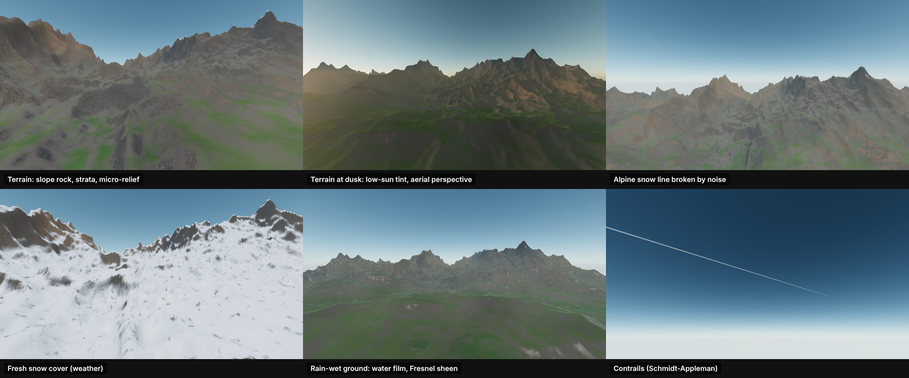
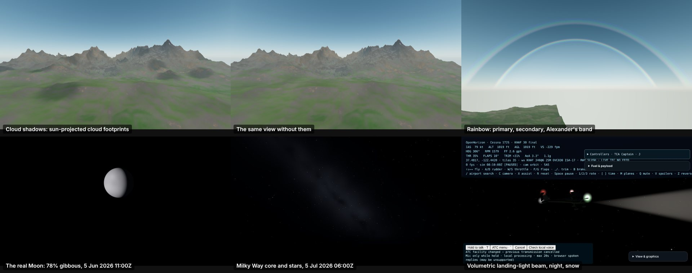
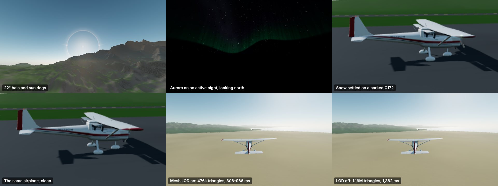

# Shaders and physics mods: inventory

This page lists what the shader and physics work added to OpenHorizon, where it lives, and how each piece is checked. The design notes and measurements are in [PROGRESS.md](../PROGRESS.md) and the plan is in [plans/improvement-20.md](plans/improvement-20.md).

*Rendered in the `tests/browser` preview harnesses through the production shaders: `terrain-shader-preview.html` (views `near`, `dusk`, `snow`, `near&snowcover=1`, `far&wet=1`) and `trails-preview.html`.*

*Top row and the Moon and Milky Way: `terrain-shader-preview.html` with `clouds=1`, `rainbow=1`, `date=` and `look=`. Landing-light beam: the full sim, a C172 on a 3 nm final at KHAF at night in light snow, orbit camera.*

*Halo and aurora: `terrain-shader-preview.html` with `halo=1&look=sun&fov=100` and `aurora=1&look=0,14&fov=100`. Airframe: the full sim at KHAF, orbit camera, snow pinned with `__ohAirframeWx`. LOD: the same paused frame read off the canvas with `__ohLod(true)` and `__ohLod(false)`; 0.05% of its pixels differ by more than 8/255.*

## Shaders and visual effects

| Effect | Module | What it does | Checked by |
|---|---|---|---|
| Terrain shading | `src/world/terrain-shader.ts` | Band-limited fBm detail that fades out before it can shimmer. Adds slope rock with warped strata and an alpine snow line broken by noise. Lighting is hemispheric ambient with ground bounce, plus micro-relief normals (analytic gradient), snow glint and aerial perspective. The Full and Lite tiers are separate programs (`TERRAIN_LITE` compiles the fBm out); software GL runs both sides of a uniform branch, so only a compile-time tier saves anything there. | `terrain-shader.test.ts`, `terrain-shader-math.test.ts`, preview `?count=1`, `?quality=0` |
| Wet and snowy ground | terrain shader, `src/render/surface-materials.ts` | A water film with Fresnel sky sheen on rock, soil and built-up ground (vegetation soaks it up), and fresh snow settling below the steeps. Wet pavement gets lower roughness and puddles. | `weather-effects.test.ts` (surface state) |
| Windscreen | `src/render/windscreen.ts` | Drops bead and creep at rest, and stream with airspeed. Unheated glass frosts as airframe ice builds. | in-sim renders (rain sweeps) |
| Falling rain and snow | `src/render/precipitation.ts` | A camera-centred, GPU-wrapped particle field with no per-particle CPU work. Rain streaks stretch with the relative airflow, snow flakes sway, and the 737 cabin stays dry. | in-sim renders (rain, snow and storm sweeps) |
| Lightning | `src/render/lightning-bolt.ts`, `src/sim/weather/lightning.ts` | Poisson strikes from reported storms or heavy radar cells. 3D forked bolts with return strokes, a sky flash, and thunder delayed at 343 m/s. | `lightning.test.ts` |
| Contrails and wingtip vapour | `src/render/contrails.ts` | Schmidt–Appleman formation (Schumann 1996 fit) and humid high-lift tip vapour. Sub-pixel ribbons are widened with coverage-scaled alpha. | `weather-effects.test.ts` |
| Fair-weather cumulus | `src/render/clouds.ts`, `src/sim/environment/cumulus.ts` | Raymarched puffs over living thermals, with the base at the lifting condensation level (about 125 m per °C of spread). | `environment/cumulus.test.ts` |
| Ocean | `src/render/ocean.ts` | Subsurface glow through steep crests toward a low sun. | renders |
| Cloud shadows | `src/render/cloud-shadows.ts`, terrain shader | Each visible cloud mass's footprint is projected onto the ground along the sun into a darkness map; the terrain dims its direct sun, glint and sheen there. Shadows lie under the visible clouds and fall far off for a low sun. | `cloud-shadows.test.ts` |
| Rainbow | `src/render/sky.ts`, `src/render/rainbow.ts` | A primary bow (40.6–42.4°, red outside) and a reversed secondary (50.3–53.5°) around the antisolar point, with Alexander's dark band between. It shows in rain with the sun out below 42°. | `rainbow.test.ts` |
| Night sky | `src/render/sky.ts`, `src/math/lunar.ts` | The real Moon (Almanac series), shaded as a sphere so its phase and terminator are right, with earthshine. Stars sit on the equatorial sphere and turn about the pole, with a magnitude spread, colours, twinkle and horizon extinction. The Milky Way follows the galactic plane, brightest toward Sagittarius. | `lunar.test.ts` (Jan 2024 phases), `rainbow.test.ts` |
| 22° halo and sun dogs | `src/render/sky.ts`, `src/render/sky-optics.ts` | Hexagonal ice plates in thin cirrostratus: a sharp, red-inside ring at 22° from the sun and parhelia at the sun's elevation, 22°/cos(elevation) out, with white tails. Only with thin high cloud, no low deck and the sun out; sun dogs fade above 45–60° of sun elevation. | `sky-optics.test.ts`, preview `?halo=1&look=sun` |
| Aurora and meteors | `src/render/sky.ts`, `src/render/sky-optics.ts` | Curtains toward the pole above about 52° latitude: oxygen green at the foot turning violet higher up, with fine drifting rays. Activity is drawn per night from the date, so a night looks the same for everyone. Occasional meteors streak along great circles. | `sky-optics.test.ts`, preview `?aurora=1` |
| Airframe weather | `src/render/airframe-weather.ts` | Rime on the surfaces facing the airflow (from the icing model's thickness), snow that settles on a parked airplane in about 20 minutes of moderate snow and blows off on the roll, and darker, glossier rain-wet paint. Patched into the exterior materials only; the flight deck, the cabin and materials shared with other airframes are left alone. | `airframe-weather.test.ts`, `__ohAirframeWx` renders |
| Landing-light beams | `src/render/landing-beam.ts` | A volumetric cone from the nose. The shader integrates in-scattered light along each view ray, with inverse-square and off-axis falloff, from outside or inside the cone. It shows in rain, snow and fog at night and is cut at the ground. | `landing-beam.test.ts` |
| Tyre smoke | `src/render/tire-smoke.ts`, `src/sim/touchdown.ts` | Instanced puffs at the main-gear contacts, scaled by touchdown speed and firmness. | `touchdown.test.ts` |
| 737-800 cabin | `src/render/cabin-737.ts` | A full-length Sky Interior cabin behind a flight deck at the real nose station. | `render/cabin-737.test.ts` |
| Google Maps layer | `server/google-tiles.mjs`, `src/world/imagery-source.ts` | Opt-in official Map Tiles API imagery on the terrain, with the API key kept server-side. | `google-tiles.test.ts` |

## Physics mods

| Model | Module | What it models | Checked by |
|---|---|---|---|
| Turbulence | `src/sim/wind.ts` | MIL-F-8785C Dryden. Low-altitude and high-altitude scales, exact Ornstein–Uhlenbeck steps, a spanwise roll gust, and no vertical gusts on the ground. | `environment/physics-mods.test.ts` (RMS and correlation over 2 h) |
| Convective and lee-rotor turbulence | `src/sim/weather/turbulence-sources.ts` | Thunderstorms and radar cells, and rotor downwind of ridges in strong wind. | `turbulence-sources.test.ts` |
| Thermals and ridge lift | `src/sim/environment/thermals.ts` | A sun-driven thermal lattice with a mixed-layer profile, downwind lean and a life cycle. Ridge lift is U·∇h, with sink in the lee. | `physics-mods.test.ts` |
| Microburst windshear | `src/sim/environment/microburst.ts` | A Stokes stream-function field (mass is conserved exactly) and an F-factor detector with a 2 s low-pass, giving jets their reactive WINDSHEAR alert. | `physics-mods.test.ts` |
| Wake turbulence | `src/sim/environment/wake.ts`, `src/sim/atc/wake-caution.ts` | Lamb–Oseen vortex pairs that sink, drift and decay, rolling the aircraft behind them. The tower issues wake cautions. | `physics-mods.test.ts`, `atc/wake-caution.test.ts` |
| Airframe icing | `src/sim/systems/airframe-ice.ts` | E·LWC·V accretion in the supercooled window, CLmax loss, added drag, anti-ice and melt. | `physics-mods.test.ts` |
| Runway contamination | `src/sim/environment/runway-surface.ts` | Braking-action friction from the METAR, slush drag, and hydroplaning above 9·√p kt. | `physics-mods.test.ts` |
| Structural limits | `src/sim/systems/structure.ts` | Certification-category limit and ultimate loads, an overstress latch, and wing failure. | `physics-mods.test.ts` |
| Total-energy variometer | `src/sim/vario.ts` | TE-compensated climb for gliders, with audio tones. | `vario.test.ts` |
| Tyre stick-slip | `src/sim/gear.ts` | Static friction at standstill, so brakes hold against wind and a full-power run-up. | `gear-stiction.test.ts` |
| Large-sideslip and reversed-flow aero | `src/sim/aero.ts`, `src/sim/aircraft.ts` | In-plane (cos²β) lift, sinβ·cosβ dihedral and full-range α, so a parked airplane survives a thunderstorm. | `parked-in-wind.test.ts` |
| Unpowered trim | `src/sim/trim.ts` | Gliders trim on their airbrakes, which gives steady final-approach spawns. | `glider-final-trim.test.ts` |
| Boundary-layer wind | `src/sim/wind.ts` | The METAR wind is the 10 m wind: a log law below it, a rise to the gradient wind above (≈1.6× over land, ≈1.25× over the sea) and Ekman veer (clockwise in the north). The approach wind gradient follows from it. | `wind-profile.test.ts` |
| Mountain lee waves | `src/sim/environment/thermals.ts` | Standing waves downwind of the upwind ridge: λ = 2πU/N, ≈N·A strong, sink on the lee slope and the first lift ¾λ downwind. They decay downstream and are killed by convection. | `environment/lee-waves.test.ts` |
| Propeller gyroscopics | `src/sim/prop-effects.ts` | H × Ω precession: pitching down yaws left (the taildragger tail-up swing). | `prop-gyroscopics.test.ts` |
| Engine failure asymmetry | `src/sim/systems/engine-out.ts`, `src/sim/aircraft.ts` | With one side's engine group out, the unbalanced live thrust and the dead fans' windmilling drag yaw the nose toward the dead side (twins at 16% of the span out, four-engine pairs at 25.5%). It takes rudder to fly straight. | `engine-out-flight.test.ts`, `engine-out-rain-humidity.test.ts` |
| Heavy rain on the airframe | `src/sim/weather/heavy-rain.ts`, `src/sim/environment/index.ts` | Water films and drop impacts (Bezos et al., 1992): nothing in light rain, a few per cent of CLmax and some drag in a +TSRA downpour. Only in the rain shaft, at or below the top of the deck it falls from, and on top of any ice. | `environment/heavy-rain-env.test.ts` |
| Humid air | `src/sim/weather/humidity.ts`, `src/sim/aircraft.ts`, `src/sim/trim.ts` | Water vapour from the METAR dew point (Magnus) carried aloft at a constant mixing ratio: the air is up to 1.5% thinner on a muggy day, and a piston engine's charge loses the vapour's 3–4%. Trim solves in the same air, so humid-day final spawns arrive trimmed. | `humid-air-flight.test.ts` |
| Brake heating and fade | `src/sim/systems/brakes.ts`, `src/sim/gear.ts` | Friction work heats a sink scaled to the airframe and convection cools it. GA linings fade above 300 °C, carbon above 1,000 °C. BRAKES HOT and BRAKES FADING cautions. | `brakes-thermal.test.ts` |

All of it is inert in calm, clear, dry air, so the POH-validated flight model is unchanged there (`npm run validate`). It can be switched off under **View & graphics → Realism**, or with typed commands (`HELP`).

## Frame rate

| Optimizer | Module | What it does | Evidence |
|---|---|---|---|
| Terrain mesh level of detail | `src/world/terrain-lod.ts`, `src/world/tiles.ts` | Each tile draws its grid at stride 1, 2, 4 or 8, chosen from the projected cell size at its nearest point (8 px; 12 px on the lite tier), with hysteresis. Coarse levels index the same vertices; skirts deepened by twice the worst coarse-edge deviation keep neighbours on different levels crack-free. | Same-scene A/B, 1.48× FPS at the same resolution; renders indistinguishable (`terrain-lod.test.ts`) |
| Coverage culling | `src/world/tiles.ts` | Coarse rings leave out the triangles finer ready tiles cover whole. | Same-scene A/B, 1.13× FPS (`terrain-coverage-cull.test.ts`) |
| Compile-time lite tier | `src/world/terrain-shader.ts` | The Performance preset, and dynamic quality, use a terrain program with the fBm compiled out: about the original shader's cost. | Preview `?time=`: full 372–381 ms, lite 232–246 ms |
| Dynamic resolution and quality | `src/render/adaptive-resolution.ts` | Holds the frame-rate target by scaling the pixel ratio. A median-of-five filter ignores single hitches, and slow machines adapt too. Below the resolution floor it drops the terrain to the lite tier, and probes back with exponential backoff. | `adaptive-resolution.test.ts` (simulated GPU) |
| Frame clock | `src/sim/frame-clock.ts` | The background metronome steps hidden tabs only. It used to step visible pages on machines slower than 400 ms a frame, rendering extra frames between rAF callbacks and feeding the resolution controller zero or negative frame times. | `frame-clock.test.ts` |

End to end against the branch base (GPU-synchronised, every rendered frame counted, KHAF with every tile loaded): 1,230 ms per frame before, 328 ms now at default settings (3.75× FPS), and 1,212 ms at the original's resolution with every new shader on (1.01×). The details are in [PROGRESS.md](../PROGRESS.md) under "Frame rate across the sim".
